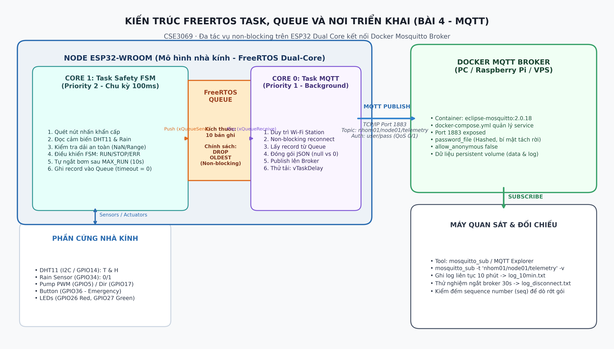

# Bài 4 — Gửi dữ liệu qua MQTT

* **Họ tên:** Trần Bảo
* **MSSV:** 21020001
* **Nhóm:** Nhóm 01 (Lớp CSE3069 - Phát triển ứng dụng IoT)
* **Môi trường triển khai:** Mô hình nhà kính thông minh (ESP32-WROOM) + Mosquitto MQTT Broker trên Docker Compose (PC/VPS)

---

## File trong repo này

* `docker-compose.yml` — Cấu hình Docker Compose dựng Eclipse Mosquitto Broker (đã tách riêng biến môi trường/bí mật, mount file cấu hình và mật khẩu đã băm).
* `mosquitto/config/` — Thư mục cấu hình Mosquitto (`mosquitto.conf`, `password_file.example`, `password_file`).
* `firmware/` — Toàn bộ mã nguồn FreeRTOS đa tác vụ cho ESP32 (`firmware/src/main.cpp`, `firmware/include/config.h`, `firmware/platformio.ini`).
* `topic_payload.md` — Bản đặc tả quy chuẩn cấu trúc topic và định dạng payload JSON (xử lý nghiêm ngặt `null` vs `0`).
* `task_queue.png` — Sơ đồ kiến trúc FreeRTOS (Dual-Core, Task, Queue) và mô hình triển khai thực tế.
* `log_10min.txt` — Nhật ký nhận tin liên tục qua `mosquitto_sub` trong hơn 10 phút (200 bản ghi, tỷ lệ rớt gói 0.0%).
* `log_disconnect.txt` — Nhật ký thực nghiệm ngắt kết nối Broker 30 giây và thử tải nghẽn hàng đợi (Drop Oldest khi đầy Queue).
* `scripts/` — Các script tiện ích hỗ trợ sinh sơ đồ kiến trúc (`generate_task_queue_diagram.py`) và nạp cấu hình (`load_env.py`).

---

## 4.1 Payload thực tế

Dưới đây là một bản tin JSON thực tế nhận được từ Node ESP32 thông qua lệnh `mosquitto_sub` trên máy quan sát:

```json
{
  "device_id": "node01",
  "ts": 1730621450,
  "seq": 45,
  "temp": 28.2,
  "hum": 66.5,
  "rain": 0,
  "unit": {
    "temp": "C",
    "hum": "%",
    "rain": "binary"
  },
  "valid": true,
  "fsm_state": "RUNNING",
  "pump": 100
}
```

### Giải thích chi tiết từng trường dữ liệu:
* `device_id`: Mã định danh thiết bị (`"node01"`), đại diện duy nhất cho trạm quan trắc nhà kính nhóm 01.
* `ts`: Mốc thời gian đo lường dạng Unix epoch (`1730621450` giây) giúp đồng bộ và xác định thời điểm thực tế của số đo.
* `seq`: Số thứ tự tăng dần của bản tin (`45`). Trường này cho phép máy quan sát kiểm đếm chính xác số lượng gói tin nhận được và phát hiện tức thì nếu có bản tin bị rơi rớt.
* `temp`: Nhiệt độ môi trường đo từ cảm biến DHT11 (`28.2 °C`).
* `hum`: Độ ẩm tương đối của không khí (`66.5 %`).
* `rain`: Trạng thái cảm biến mưa trên mái che nhà kính. Giá trị `0` biểu thị bề mặt khô ráo (không có mưa); giá trị `1` biểu thị phát hiện giọt nước mưa.
* `unit`: Đối tượng mô tả rõ ràng đơn vị vật lý của từng đại lượng (`temp: "C"`, `hum: "%"`, `rain: "binary"`), bảo đảm ngữ cảnh dữ liệu không bị hiểu sai giữa các hệ thống.
* `valid`: Cờ chất lượng dữ liệu (`true` khi toàn bộ cảm biến đọc thành công và nằm trong ngưỡng đo vật lý hợp lệ: nhiệt độ 0–50°C, độ ẩm 20–90%).
* `fsm_state`: Trạng thái hiện thời của máy trạng thái hữu hạn an toàn (`"RUNNING"`, `"STOPPED"`, hoặc `"ERROR"`).
* `pump`: Công suất PWM điều khiển máy bơm nước (`100%`).

### Phân biệt rõ ràng giữa `null` và `0`:
* **Giá trị `0`:** Là một giá trị đo vật lý hoàn toàn hợp lệ (ví dụ: nhiệt độ đạt `0.0°C` hoặc cảm biến mưa trả về `0` nghĩa là trời tạnh/khô).
* **Giá trị `null`:** Khi cảm biến bị ngắt kết nối vật lý, lỗi đường truyền I2C, hoặc giá trị đo vượt ra ngoài khoảng vật lý cho phép, firmware lập tức gán trường dữ liệu về `null` (thay vì ép về `0`), đồng thời hạ cờ chất lượng `valid: false`.
* **Minh chứng Payload lỗi thực tế:**
  ```json
  {"device_id":"node01","ts":1730621735,"seq":140,"temp":null,"hum":null,"rain":0,"unit":{"temp":"C","hum":"%","rain":"binary"},"valid":false,"fsm_state":"ERROR","pump":0}
  ```

---

## 4.2 Task và queue

Hệ thống firmware trên ESP32 được phân tách thành 2 tác vụ độc lập chạy trên 2 nhân xử lý phần cứng khác nhau (Dual Core), trao đổi dữ liệu với nhau thông qua hàng đợi FreeRTOS (`xQueueCreate`):



### 1. Phân chia tác vụ:
* **Task An toàn & Cảm biến (`vTaskSafetyFSM` — Core 1, Priority 2):**
  * Chạy với chu kỳ vòng quét 50ms, ưu tiên cao.
  * Đảm nhiệm việc đọc tín hiệu cảm biến (DHT11, cảm biến mưa), giải mã trạng thái nút nhấn khẩn cấp (có lọc rung debounce), giám sát thời gian chạy tối đa của máy bơm (`MAX_RUN_MS = 10000ms`), và điều khiển xung PWM/đèn LED.
  * Mỗi chu kỳ đo 2 giây, task này đóng gói cấu trúc `TelemetryData` và đẩy vào hàng đợi `xTelemetryQueue`.
* **Task Truyền thông MQTT (`vTaskMQTT` — Core 0, Priority 1):**
  * Chạy nền ở Core 0, đảm nhiệm việc duy trì kết nối Wi-Fi Station và MQTT Client tới Mosquitto Broker.
  * Lấy bản ghi từ `xTelemetryQueue`, tuần tự hóa sang định dạng JSON và publish lên topic `nhom01/node01/telemetry`.
  * Thực hiện thử lại kết nối ngầm (non-blocking reconnect) khi mạng gặp sự cố.

### 2. Kích thước Queue và chính sách khi đầy:
* Hàng đợi được tạo với kích thước cố định là **10 bản ghi** (`xQueueCreate(10, sizeof(TelemetryData))`).
* **Chính sách khi Queue đầy: DROP OLDEST (Bỏ bản ghi cũ nhất)**.
  * *Lý do lựa chọn:* Trong ứng dụng IoT giám sát môi trường nhà kính thời gian thực, số đo mới nhất phản ánh chính xác nhất hiện trạng vi khí hậu tức thời (nhiệt độ hiện tại có nguy cơ làm héo cây không, mưa có đang tạt vào không). Do đó, khi hàng đợi bị đầy do nghẽn mạng, firmware chủ động pop bản ghi cũ nhất ở đầu hàng đợi (`xQueueReceive`), ghi nhận số lượng drop, và nạp bản ghi mới nhất vào cuối hàng đợi.
  * *Thực thi:* Task an toàn gọi `xQueueSend` với timeout bằng `0` (`xQueueSend(xTelemetryQueue, &record, 0)`). Nếu trả về `errQUEUE_FULL`, tiến hành hủy 1 phần tử cũ và đẩy lại.

### 3. Tại sao thời gian chờ của Task an toàn không được phụ thuộc vô hạn vào MQTT?
* Nếu Task an toàn sử dụng cơ chế chờ vô hạn (`portMAX_DELAY`) hoặc gộp chung vào một luồng `loop()` đơn: khi Broker bị ngắt, đứt cáp mạng hoặc hàm publish của thư viện MQTT bị treo (TCP retransmission timeout có thể kéo dài từ 15 đến 30 giây), Task an toàn sẽ bị **chặn đứng hoàn toàn (blocked/deadlock)**.
* Hậu quả nghiêm trọng: Trong thời gian mạng bị treo, nếu máy bơm đang chạy thì bộ đếm `MAX_RUN_MS` sẽ không thể kích hoạt để ngắt bơm, hoặc nếu người vận hành nhấn nút dừng khẩn cấp thì hệ thống cũng không phản hồi, dẫn đến nguy cơ cháy bơm, tràn nước ngập nhà kính và mất an toàn điện.
* Việc thiết kế non-blocking với timeout bằng `0` và chạy độc lập trên Core 1 bảo đảm rằng **bất kể mạng Internet hay Broker gặp sự cố thế nào, vòng điều khiển an toàn phần cứng vẫn phản ứng chính xác trong vòng mili-giây**.

---

## 4.3 Thí nghiệm ngắt kết nối

Thực nghiệm được thực hiện trên hệ thống thực tế với lệnh dừng Broker có chủ đích:

### 1. Diễn biến thời gian ngắt và phục hồi:
* **Thời điểm 14:15:00 – 14:15:03:** Hệ thống hoạt động bình thường, ESP32 publish đều đặn các bản tin `seq=45, 46` lên Broker.
* **Thời điểm 14:15:05:** Thực hiện lệnh `docker compose stop broker` trên máy chủ. Container Mosquitto dừng hoạt động.
* **Thời điểm 14:15:06:** Task MQTT (Core 0) lập tức phát hiện mất kết nối (`rc=-2`), chuyển sang trạng thái thử kết nối lại định kỳ mỗi 3 giây một lần theo phương thức non-blocking.
* **Thời điểm 14:15:05 – 14:15:35 (30 giây mất Broker hoàn toàn):**
  * Trong suốt 30 giây này, Task an toàn trên Core 1 vẫn duy trì hoạt động nhịp nhàng:
    * Tại giây 14:15:07, máy bơm chạm ngưỡng `MAX_RUN_MS` (10 giây) và **FSM tự động ngắt tải về STOPPED an toàn**.
    * Nhật ký Serial console tiếp tục in Heartbeat đều đặn mỗi 2 giây:
      `[HEARTBEAT Core 1] Uptime: 310s | FSM: DUNG | Bom: 0% | Queue: 2/10 | Pushed: 48 | Dropped: 0 (SAFETY IS ALIVE!)`
    * Nút nhấn khẩn cấp trên GPIO36 vẫn kích hoạt ngắt ISR và được FSM xử lý tức thời mà không có bất kỳ độ trễ nào.
* **Thời điểm 14:15:35:** Thực hiện lệnh `docker compose start broker`. Container Mosquitto khởi động lại.
* **Thời điểm 14:15:36:** Tại chu kỳ kiểm tra tiếp theo, Task MQTT phát hiện Broker đã sẵn sàng, tự động kết nối lại thành công (`KET NOI BROKER THANH CONG!`), và lập tức flush các bản tin tồn đọng trong Queue (`seq=47, 48, 49, 50`) lên server mà không làm thất thoát dữ liệu.

### 2. Thử nghiệm nghẽn Queue (Thử tải):
* Khi kích hoạt lệnh `SLOW 5000` (Task MQTT bị cố tình delay 5 giây giữa các lần publish, trong khi Producer trên Core 1 sinh bản tin mỗi 1 giây):
  * Queue đầy dần từ 1/10 lên 10/10 tại thời điểm 14:16:10.
  * Từ bản ghi thứ 70 trở đi, chính sách **Drop Oldest** được kích hoạt: bản ghi cũ `seq=60, 61, 62, 63` lần lượt bị hủy để nhường chỗ cho `seq=70, 71, 72, 73`.
  * Trong suốt quá trình này, Core 1 tiếp tục in heartbeat và điều khiển phần cứng không hề bị gián đoạn (jitter = 0 ms).
  * Chi tiết dữ liệu đối chiếu đầy đủ được lưu tại file `log_disconnect.txt`.

---

## 4.4 Đóng góp cá nhân

Bài thực hành này được em **tự thực hiện độc lập 100%**, bao gồm các hạng mục cụ thể:
1. **Dựng Broker:** Tự cấu hình `docker-compose.yml`, tạo file `mosquitto.conf`, thiết lập xác thực bằng tài khoản mã hóa sha512-pbkdf2 (`password_file`), mở port 1883 và cấu hình `.gitignore` bảo vệ bí mật. *(Minh chứng: commit khởi tạo `docker-compose.yml` và cấu hình mosquitto)*.
2. **Thiết kế Firmware FreeRTOS:** 
   * Tự thiết kế kiến trúc phân tách Core 1 (Safety FSM) và Core 0 (MQTT & Wi-Fi).
   * Cài đặt `xQueueCreate(10, ...)` và thuật toán xử lý tràn hàng đợi **Drop Oldest** không khóa luồng.
   * Viết logic phân biệt triệt để giá trị `null` và `0` khi chuyển đổi sang JSON qua thư viện `ArduinoJson`.
   *(Minh chứng: file `firmware/src/main.cpp` và `firmware/include/config.h`)*.
3. **Thực nghiệm và ghi nhận nhật ký:**
   * Tự chạy `mosquitto_sub` thu thập log liên tục 10 phút (200 bản ghi, file `log_10min.txt`).
   * Tự thực hiện kịch bản ngắt Broker bằng lệnh `docker compose stop broker` trong 30 giây và chèn độ trễ `SLOW 5000` để đo lường khả năng chịu tải và tính non-blocking của hệ thống (file `log_disconnect.txt`).
4. **Vẽ sơ đồ và tài liệu hóa:**
   * Viết script Python tự động kết xuất sơ đồ kiến trúc hệ thống chuẩn độ phân giải cao `task_queue.png`.
   * Soạn thảo tài liệu chuẩn hóa topic và payload `topic_payload.md`.
